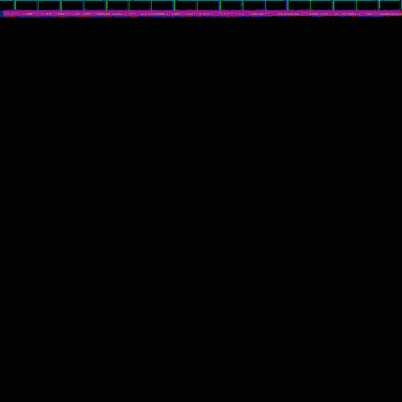
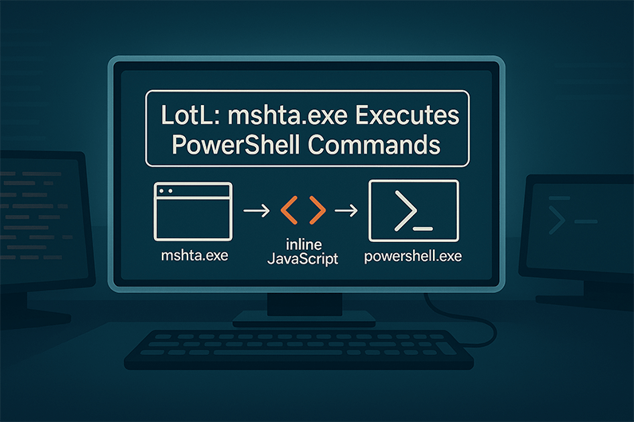

<h1 align="center">Hi, I'm Tageldin Gasmalla 👋</h1>

<h3 align="center">Software Engineering Student | Web Developer | Building Real-World Solutions</h3>

  
  &nbsp;&nbsp;
  

I'm a Software Engineering student who loves turning ideas into working products. I learn best by building, so most of what I know comes from real projects beyond the classroom.

I'm growing from front-end into full-stack development, with a focus on practical apps that solve real problems.

---

## 🚀 About Me

- 🎓 Software Engineering student
- 💻 Web developer moving toward full-stack
- 🛠️ Building practical apps, from clinic systems to study tools
- 🌍 Comfortable working in both Arabic and English
- 📚 Currently strengthening my software engineering fundamentals

## 🧰 Tech Stack

## 📌 Featured Projects

- **[clinic\_](https://github.com/Tigo1123/clinic_)**: Bilingual Arabic/English clinic management system
- **[student-planner](https://github.com/Tigo1123/student-planner)**: Academic planner with calendar, tasks, and dashboard
- **[smartapply-rw](https://github.com/Tigo1123/smartapply-rw)**: Application helper
- **[personalPortfolio](https://github.com/Tigo1123/personalPortfolio)**: My personal portfolio site

## 📫 Let's Connect

- GitHub: [@Tigo1123](https://github.com/Tigo1123)
